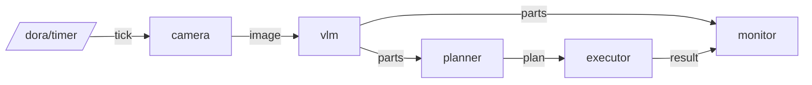

# μ は幅でしか流通していない — 材質の見積もりで安全とタクトを両立するピッキング


松尾研 Physical AI 応用編1 最終課題。動画：（YouTube の URL）

## 概要
部品の静摩擦係数 μ は、図面と違って「幅」でしか手に入らない（例：POM–鋼で 0.07〜0.16）。
μ を高く見積もると落とし、低く見積もると遅くなる。
本作品では、VLM（Gemini Robotics-ER 2）が部品の材質の **候補** を挙げ、文献値の表から **候補の中で最も小さい μ の下限** を引いて、持ち上げの加速度を決める。
認識が曖昧でも「落とす」ではなく「遅くなる」に倒れる設計にしている。

| 戦略 | 成功率 | 持ち上げ＋移動の平均時間 | 最悪の部品での摩擦の余裕 |
|---|---|---|---|
| A 一律・代表値 | 91.7% | 0.75 秒 | −26.7% |
| B 一律・最悪値 | 100% | 2.51 秒 | +17.7% |
| C-VLM（Gemini の候補） | 100% | 1.92 秒 | +17.7% |
| C（材質を完全に知っている場合） | 100% | 1.33 秒 | +17.7% |

3 材質 × 20 seed、Genesis 1.4.3（楕円錐の摩擦、substeps=10）、Docker で実行。

## 構成（dora-rs 1.0.1）



## 再現手順

```bash
docker compose build
docker compose run --rm sim python -m pytest -q tests          # テスト
docker compose run --rm sim python sim/evaluate.py 20          # 戦略 A/B/C の評価 → outputs/eval/
docker compose run --rm sim bash -c 'cd dora && dora run dataflow.yml'   # dora の配線（保存済みの VLM 応答で）
```

Microduck の試験台を動かすには、先に `bash scripts/fetch_microduck_assets.sh` を実行する。
Gemini を実際に呼ぶには、`.env` に `GEMINI_API_KEY=...` を書く（`.env` は git の対象外）。

## データと出典
μ の文献値は `data/friction_literature.csv`、出典は `data/SOURCES.md`。原文で値を確かめたもの（`verified=yes`）だけを使う。

## ライセンス
- このリポジトリのコード：Apache License 2.0（`LICENSE`）
- Microduck のモデル：[pollen-robotics/microduck_rl](https://github.com/pollen-robotics/microduck_rl)。モデル記述（`.xml`）は Apache-2.0、3D 形状ファイル（`.stl`）は CC BY-NC-SA 4.0（© Pollen Robotics）。形状ファイルはこのリポジトリに含めず、`scripts/fetch_microduck_assets.sh` で固定版から取得する。くちばしの試験台では、頭部の部品のうち下あごを切り出して関節を足している（改変）
- Franka Emika Panda のモデルは Genesis に同梱のものを使用
