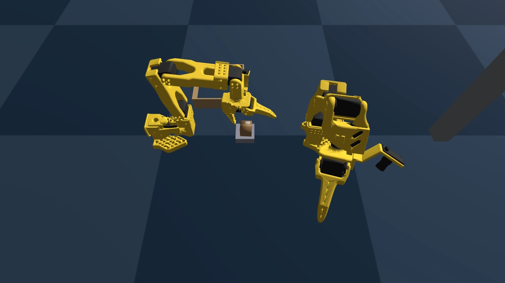
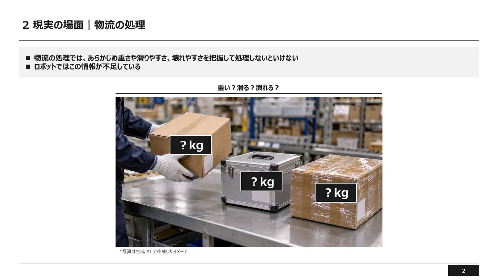
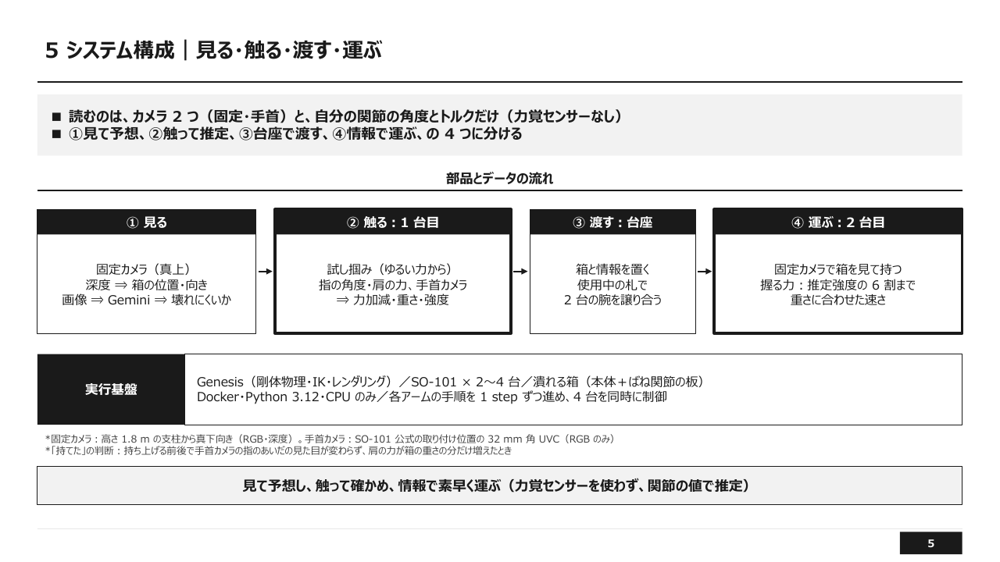
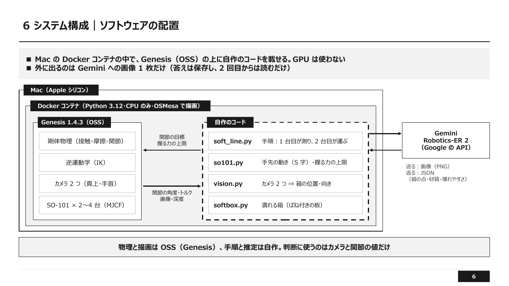
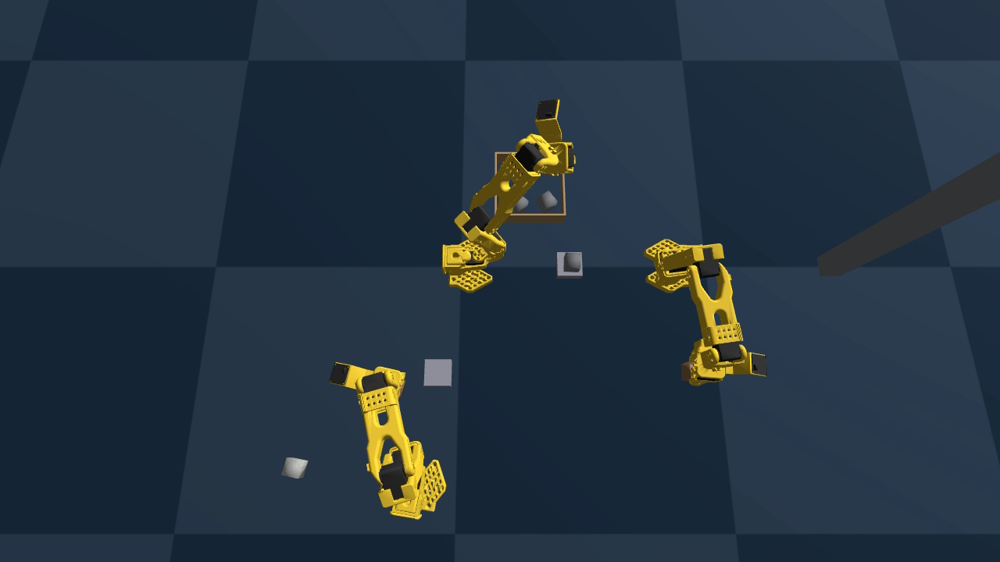
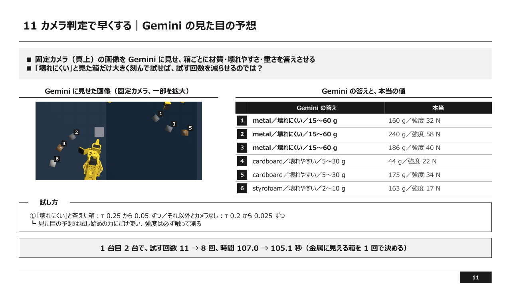
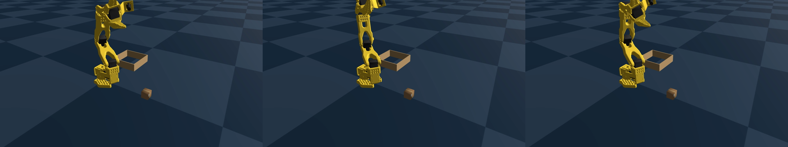
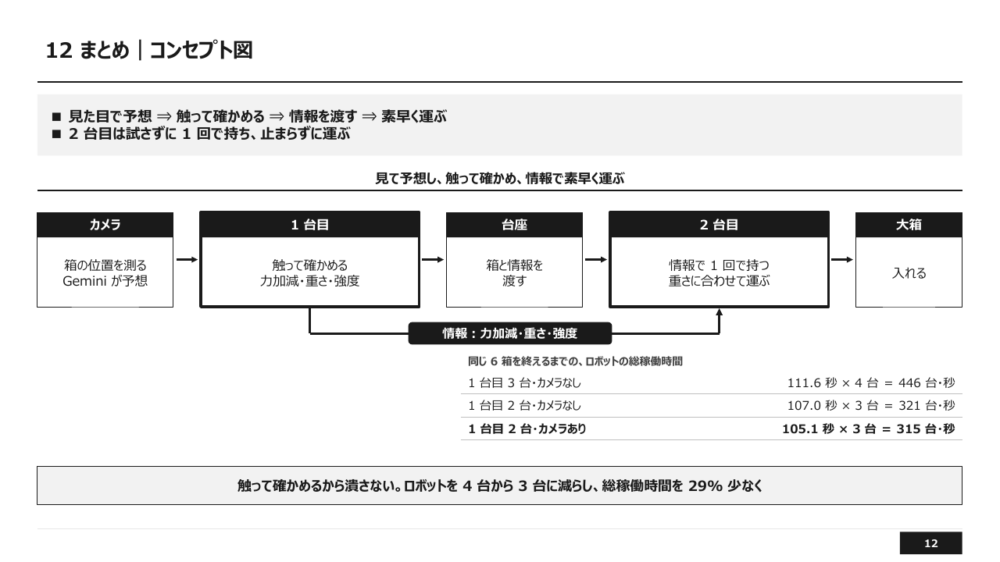

# 重さも強度もわからない箱を運搬するロボット作業

触って確かめてから受け渡す 2 台の SO-101　｜　PAI 応用編1 最終課題　説明資料

- omnicampus アカウント名：{{ACCOUNT}}
- 動画（YouTube）：{{YOUTUBE_URL}}　※映像は約 2〜4 倍速。倍速は各ページの「映像」の見出しに記載
- GitHub：{{GITHUB_URL}}

---

## 1. 概要・目的・工夫した点

### 1.1 目的

物流でロボットを活用するために、ロボットが箱を潰さず落とさずに持ち上げることが重要。
ただし全てのロボットに力覚センサーをつけると費用がかさむため、
今回、VLMと古典制御を組み合わせて、作業を行うことができるか取り組んだ。

### 1.2 概要

物流の現場では、箱の重さ・滑りやすさ・壊れやすさを分かったうえで扱う必要がある。ロボットにはこの情報がない。
本作品では、物理シミュレータ Genesis の中で、オープンハードウェアのロボットアーム SO-101 を動かし、2つの役割を与えた。

- **1 台目（確かめる）**：ゆるい力から少しずつ強めて箱を試し掴みし、持ち上がる力（力加減）・重さ・強度を、自分の関節の値から測る。測った情報を付けて、箱を台座に置く
- **2 台目（素早く運ぶ）**：受け取った情報で、試さずに 1 回で箱を持ち、大箱へ運ぶ
- **カメラ**：真上の固定カメラの画像を Gemini（Robotics-ER 2）に見せ、「壊れにくい」と見た箱だけ、試し掴みを強く行う。

これらを力覚センサーを使わずに、カメラ 2 つ（真上・手首）の画像と、ロボット自身の関節の角度・トルクで行う。

同じ 6 箱（重さ・強度・摩擦はランダム）を、次の 3 つの構成で処理した。

| 1 台目 | カメラ | 時間 | 試した回数 | 総稼働時間（台数 × 時間） |
|---|---|---|---|---|
| 3 台 | なし | 111.6 秒 | 13 回 | 446 台・秒 |
| 2 台 | なし | 107.0 秒 | 11 回 | 321 台・秒 |
| 2 台 | あり | 105.1 秒 | 8 回 | 315 台・秒 |

- 3 つの構成とも、6 箱すべてを潰さず・落とさずに大箱へ入れた
- カメラからのVLMを加えると1 台目を3台から2台に減らしても、総稼働時間は 446 → 315 台・秒（29% 減）と短くなった。

### 1.3 課題の条件との対応

| 条件 | 本作品 |
|---|---|
| 使うツール | 物理シミュレータ Genesis 1.4.3 を Docker の中で動かした（Mac の CPU だけ、GPU なし）。ロボットはオープンハードウェアの SO-101（公式の MJCF モデル）。ROS・Gazebo と実機は使っていない（§4.2・§10） |
| AI の活用 | VLM の Gemini Robotics-ER 2 に真上のカメラの画像を見せ、箱ごとの位置・材質・重さ・壊れやすさを答えさせた。答えは、試し掴みを始める力の選択に使った。推論だけで、学習は行っていない（§5.5・§6.3）。アームの動き（逆運動学・動作の順番・力加減の探し方）は古典制御と決まりで作り、学習した方策は使っていない（§5.2〜§5.4） |
| タスク | 2 台の SO-101 で小箱を受け渡す。1 台目が、重さ・強度・摩擦の分からない小箱を試し掴みして力加減・重さ・強度を測り、台座に置く。2 台目がその情報で台座から持ち、大箱へ運ぶ。6 箱すべてを潰さず・落とさずに大箱へ入れる（§3.1） |

### 1.4 工夫した点

| # | 工夫 | 中身 |
|---|---|---|
| 1 | 役割を「確かめる」と「運ぶ」に分けた | 試し掴みは 1 台目だけが行い、2 台目は受け取った情報で試さずに 1 回で持つ。確かめる台数と運ぶ台数を別々に増減できる（§6） |
| 2 | 力覚センサーなしで、関節の値から測った | 力加減は弱い力から少しずつ強めて探す（強い力から弱めると 1 回目で潰す）。重さは肩のトルク、強度は一定の力で握った指の角度から読む。重さの誤差は −12〜+1 g（§5.2・§5.3・§6.2） |
| 3 | VLM による材質判定 | Gemini は材質を当てるが重さは大きく外す（§6.3）。安全に関わる値（重さ・強度）は必ず触って測るので、答えが外れても潰さない（§5.5・§7.3） |
| 4 | カメラによる処理 | 真上のカメラの画像処理から箱の位置と向きを測り、逆運動学で関節の角度を計算する。手首のカメラは、色の画像だけを使い、持てたかを確かめる。（§3.3・§5.1） |

---

## 2. 現実の場面

物流の処理では、あらかじめ重さや滑りやすさ、壊れやすさを把握して扱わないといけない。人は持った瞬間の手応えで力を調整するが、ロボットにはこの情報が不足している。見た目が同じ箱でも、中身によって重さや潰れやすさは違う。

本作品は、この状況を「重さ・強度・摩擦がランダムで、見た目からは分からない小箱」として模した。

---

## 3. タスクと条件

### 3.1 タスク

床に置かれた小箱を、1 台目が試し掴みして台座へ置き、2 台目が台座から大箱へ運ぶ。全部の箱を、潰さず・落とさずに大箱へ入れる。

### 3.2 箱

| 項目 | 範囲 | 決め方 |
|---|---|---|
| 大きさ | 3 cm 角 | 固定 |
| 重さ | 30〜250 g | 箱ごとに一様乱数 |
| 摩擦係数 | 0.6〜1.0 | 箱ごとに一様乱数 |
| 硬さ k | 2,500〜20,000 N/m | 対数で一様乱数 |
| 強度 | k × 3 mm（7.5〜60 N） | 硬さから決まる |
| 見た目 | 段ボール・発泡・金属 | 硬さの傾向で選ぶが、2 割は入れ替える（見た目どおりでない箱を作る） |

- 箱は、本体と、2 つの側面に付けた「ばね付きの板」でできている（Genesis の MJCF）。板を押す力が強度を超えると板が沈み、沈みが 8 mm の 9 割を超えたら「潰れた」とする

### 3.3 ロボットと環境

| 項目 | 内容 |
|---|---|
| ロボット | SO-101（SO-ARM100 公式の MJCF、手首カメラ付きのモデル `so101_new_calib_camera.xml`） |
| 配置 | 2 台目を中央、1 台目を周りに 1〜3 台。それぞれの 1 台目の前に台座 |
| 真上のカメラ | 高さ 1.8 m の支柱から真下向き。RGB と深度（1280 × 1280） |
| 手首のカメラ | 公式の取り付け位置の 32 mm 角 UVC カメラ。RGB のみ（実機の UVC カメラに深度はないため） |
| 使わないもの | 力覚センサー、シミュレータの中の箱の本当の位置・重さ・強度（答え合わせにだけ使う） |

---

## 4. システム構成

### 4.1 役割の分け方

| 役割 | 担当 | 入力 | 出力 |
|---|---|---|---|
| ① 見る | 真上のカメラ＋Gemini | 画像・深度 | 箱の位置・向き、壊れにくいかの予想 |
| ② 触る | 1 台目 | 指の角度、肩のトルク、手首の画像 | 力加減・重さ・強度 |
| ③ 渡す | 台座 | 箱と情報 | ― |
| ④ 運ぶ | 2 台目 | 受け取った情報 | 握る力、運ぶ速さ |

### 4.2 ソフトウェアの配置

- Mac（Apple シリコン）の Docker コンテナの中で、Genesis 1.4.3 の上に自作のコードを載せる。GPU は使わない
- 外に出るのは、Gemini へ送る真上のカメラの画像だけ
- 4 台の腕は、それぞれの手順を Python のジェネレータで書き、シミュレータの 1 step ごとに順に進める。台座の取り合いは、ロック（排他制御）で 1 台ずつ使うようにした

| ファイル | 中身 |
|---|---|
| `handover/soft_line.py` | 手順：1 台目が測り、2 台目が運ぶ |
| `handover/so101.py` | 手先の動き（逆運動学）、握る力の上限 |
| `handover/vision.py` | 真上のカメラ ⇒ 箱の位置・向き、手首のカメラの画像の比べ方 |
| `handover/softbox.py` | 潰れる箱（ばね付きの板）、ランダムな箱の組 |

---

## 5. 方法

### 5.1 箱を見つける（真上のカメラ）

深度の画像を画素ごとの 3 次元の点に戻し、「箱の上の面」の高さの帯にあって、ロボットの色（黄・黒）でない点のかたまりを箱とする。かたまりの中心を位置、外形を囲む最小の長方形の傾きを向きとする。シミュレータの箱の座標は使わない。

### 5.2 試し掴みで力加減を測る（1 台目）

握る力の上限 τ（グリッパのモーターのトルク上限、N·m）を、0.20 から 0.025 ずつ上げながら試す。

1. 固定側の指を箱の側面に当ててから閉じる（当てずに閉じると、箱を床の上で滑らせる力が力加減に混ざった）
2. 2 cm 持ち上げ、次の 3 つが全部そろえば「持てた」とする
   - 指が何かを挟んでいる（指の角度）
   - 手首のカメラで、指のあいだの見た目が持ち上げる前と変わらない（画像の平均の差が小さい＝箱が手と一緒に上がった）
   - 肩のトルクが、空の手のときより箱の重さの分だけ増えた
3. 少しでも滑ったら、いったん置いて、1 段強い力で掴み直す

持てた τ を力加減とする。挟む力は τ × 14.5 N/(N·m)（シミュレータで校正）。

### 5.3 重さと強度を測る（1 台目）

- **重さ**：宙で箱を持ったときの肩のトルクと、空の手のときの差を、重力と腕の長さで割る
- **強度**：τ 0.4（挟む力 約 5.8 N。どの箱の強度より小さい）で握り、指の角度から箱の硬さ k を読む（硬さ 6 点で校正した表で補間）。強度＝k × 3 mm

### 5.4 運ぶ（1 台目・2 台目）

- 握る力は、力加減の 3 倍。ただし推定強度の 6 割を上限にする（推定の誤差が 2 割ほどあるため）
- 上限のせいで余裕が 2.5 倍に届かない箱は、足りない分だけゆっくり運ぶ（振られる力は速さの 2 乗）
- 余裕が 1.8 倍に届かない箱は「重さに対して弱すぎる」として運ばず、人の確認に回す（今回の 6 箱には該当なし）
- 2 台目は、受け取った情報の握る力で 1 回で持つ

### 5.5 カメラ（Gemini）で試す回数を減らす

真上のカメラの画像を Gemini Robotics-ER 2（`gemini-robotics-er-2-preview`）に見せ、箱ごとに「材質・重さ・壊れやすさ」を JSON で答えさせる。

- 「壊れにくい」と答えた箱：τ 0.25 から 0.05 ずつ（大きく刻む）
- それ以外の箱とカメラなし：τ 0.20 から 0.025 ずつ
- Gemini の答えは、試し始めの力にだけ使う。重さと強度は必ず触って測る

---

## 6. 結果

### 6.1 3 つの構成の比べ方

同じ 6 箱（seed 278）を、3 つの構成で 1 回ずつ流した。比べる量は、全部の箱の判断が終わるまでの時間と、ロボットの総稼働時間（ロボットの台数 × 時間）である。総稼働時間は、ロボットを何台、何秒動かしたか、つまり設備にかかる量を表す。

| 1 台目 | カメラ | ロボットの台数 | 時間 | 試した回数 | 総稼働時間 |
|---|---|---|---|---|---|
| 3 台 | なし | 4 台 | 111.6 秒 | 13 回 | 446 台・秒 |
| 2 台 | なし | 3 台 | 107.0 秒 | 11 回 | 321 台・秒 |
| 2 台 | あり | 3 台 | 105.1 秒 | 8 回 | 315 台・秒 |

- 3 つの構成とも、潰した箱 0、落とした箱 0、2 台目の掴み損ね 0
- 1 台目 2 台どうしで比べると、カメラで試した回数は 11 → 8 回、時間は 107.0 → 105.1 秒

### 6.2 箱ごとの値（1 台目 2 台・カメラあり）

| 箱 | 見た目 | 本当の重さ | 測った重さ | 本当の強度 | 推定強度 | 摩擦 | 力加減 τ | 試した回数 |
|---|---|---|---|---|---|---|---|---|
| 1 | 金属 | 160 g | 152 g | 32.1 N | 44.0 N | 0.71 | 0.25 | 1 |
| 2 | 金属 | 240 g | 228 g | 57.5 N | 60.0 N | 0.96 | 0.25 | 1 |
| 3 | 金属 | 186 g | 178 g | 40.1 N | 48.3 N | 0.82 | 0.25 | 1 |
| 4 | 段ボール | 44 g | 45 g | 22.3 N | 18.3 N | 0.84 | 0.20 | 1 |
| 5 | 段ボール | 175 g | 170 g | 34.2 N | 39.0 N | 0.87 | 0.20 | 1 |
| 6 | 発泡 | 163 g | 157 g | 17.1 N | 22.8 N | 0.68 | 0.25 | 3 |

- 重さの誤差は −12〜+1 g
- 強度の推定は最大 +37%（箱 1）。このため握る力の上限を推定強度の 6 割にしている

### 6.3 Gemini による推定

| 箱 | Gemini の推定（材質／壊れやすさ／重さ） | 本当 |
|---|---|---|
| 1〜3 | 金属／壊れにくい／15〜60 g | 160〜240 g、強度 32〜58 N |
| 4・5 | 段ボール／壊れやすい／5〜30 g | 44 g・175 g、強度 22・34 N |
| 6 | 発泡スチロール／壊れやすい／2〜10 g | 163 g、強度 17 N |

- 材質と壊れにくさは、6 箱とも見た目どおりに答えた
- 重さは大きく外れた（金属 160〜240 g を 15〜60 g と答えた）。重さを見た目から決めず、触って測る理由になる

---

## 7. 環境構築の難しさ

### 7.1 アームが強度・重さ・摩擦を測れる環境を作る難しさ

シミュレータの中で「触って確かめる」を成り立たせるには、箱とロボットの両方を、測れる形に作り込む必要があった。

- **潰れる箱を作る**：Genesis の剛体の箱は潰れない。本体の 2 つの側面に「ばね付きの板」を付け、押す力が強度を超えると板が沈みきる形にした（§3.2）。板が 1 枚だと、指が板のない向きで挟んだときに硬さが測れないため、2 つの向きに付けた
- **摩擦を効かせる**：Genesis は、触れた 2 つの物の摩擦係数のうち大きいほうを使う。ロボットの表面の摩擦を 0.1 に下げて、箱ごとの摩擦（0.6〜1.0）が効くようにした
- **指で正しく挟む**：当たり判定の形を単純化すると、SO-101 の指のすき間が埋まって箱が挟めなかった。形を細かく分けて包む設定にした。また、手先の目印（gripperframe）は指の真ん中ではなく、固定側の指の内側の先端にあった（箱の中心は目印から 1.9 cm 先）
- **力の目盛りを合わせる**：指のモーターの力の上限 τ と、実際に箱を挟む力の関係を測り、挟む力 ≈ τ × 14.5 N/(N·m) とした。指の角度から硬さを読む表も、硬さ 6 点で作った
- **測り方を工夫する**：
  - 強度は、床に置いたまま握ると箱が滑ったり傾いたりして測定がばらついたため、宙で持ってから測る形にした
  - 重さは、肩のトルクの「空の手との差」から求める。前の姿勢で測った空の手の値を使い回すと、誤差が大きく。箱ごとに、同じ姿勢で空の手を測り直す形にした

### 7.2 アームの動作を作る難しさ

**① 最初は、シミュレータの真値を与えて動作を作った**
箱の位置と向きに、シミュレータの中の本当の座標を使って、試し掴みから大箱までの一連の動作を作った。動作はきれいにできたが、現実のロボットは箱の本当の位置を知らない。これでは Physical AI にならないため、作り替えた。

**② カメラで測った値に切り替えた**
- 箱の位置と向きは、真上の深度カメラの画像処理で測る形にした（位置の誤差 1〜2 mm、向き 1° 以内。§5.1）
- 手首のカメラは、SO-101 公式の取り付け位置に付け、実機の UVC カメラと同じく色の画像だけを使う形にした
- 切り替えると、真値では見えなかった問題が次々に出た
  - 滑りながら上がった箱を「持てた」と判断した → 「持てたか」を、指の角度・手首カメラの画像の差・肩のトルクの 3 つで判断する形にした
  - 指を閉じるときに箱がすべり力が測定できなかった → 固定側の指を箱の側面に当ててから閉じる形にした
  - アームが箱を覆ってカメラに写らなかった → 腕を退かせて見直し、それでも見えなければ止める形にした
  - 2 台目の腕が 1 台目に接触した → 台座ごとにロックを設け、1 台ずつしか近づけない形にした

**③ 動作の AI 化は、2 つ試して断念した**

1 つ目：握る力と運ぶ速さを、学習した方策で決める
- 腕 1 台・箱 1 つの簡単な場面で、ランダムな箱 21 個について運び方 24 通りを並列に試し（482 試行）、成功を予測するモデル（ロジスティック回帰）を学習させた。このデータ集めでは、時間の都合で箱の位置に真値を使った
- 本番の場面に入れると、運ぶ時間は手書きの式の 1/3〜1/5 になったが、2 台目が運ぶ途中で箱を落とした。学習した場面（弧 90°、床の箱を掴む）と本番（最大 150° 回る、台座の箱を掴む）が違ったためである

2 つ目：カメラの画像から動作そのものを出す VLA（SmolVLA）に任せる
- SO-101 向けの VLA である SmolVLA（`lerobot/smolvla_base`、コミュニティが公開した SO-100 の実機データで事前学習されたもの）を、微調整なしで使った。シミュレータの Docker とは別に Mac 本体で動かし、カメラ 3 つ（真上・手首・正面）の画像、関節の角度、言葉の指示（「段ボールの箱を持ち上げて、茶色の箱に入れて」）を送り、返ってきた 50 コマ分の関節の動きで腕を動かした
- 結果：腕は根元の上で立ち上がった姿勢のまま、高い所（手先の高さ 27〜36 cm）を行き来しただけで、箱には一度も近づかなかった（9 秒、推論 6 回）

- 原因：①学習データは実物のカメラ映像で、シミュレータの描画とは見た目が違う ②学習データの関節の値は実機の SO-100 の度の値で、校正の基準もシミュレータの SO-101（ラジアン）と違う。今回は「学習データの平均からのずれ」を、構えの姿勢からのずれとして当てはめた ③`smolvla_base` は、手本で微調整してから使う土台である
- 使えるようにするには、シミュレータの中で手本の動作を数十〜数百回分、画像つきで記録し、微調整する必要がある。学習自体は Colab の GPU でもできるが、手本を集める仕組みと、学習したモデルを戻して確かめる仕組みを作るのは、期限内には難しかった

そのため、作品の動作は、カメラで測った値を手順に入れ、逆運動学で関節の角度を計算する古典制御とした

### 7.3 Gemini の導入の難しさ
- **画像を見せる準備**：Genesis の基本形の箱には、絵を貼るための座標（UV）がなく、段ボールや金属の見た目を描けなかった。UV 付きの立方体のモデルを作って絵を貼った
- **使える答えは壊れやすさだけ**：見た目から材質・重さ・壊れやすさを予想させたが、重さは大きく外れたため使わず（金属 160〜240 g を 15〜60 g。§6.3）、壊れやすさの予想だけを試し掴みの最初の力を決めるのに使った

---

## 8. 講義・サンプルとの関係

### 8.1 講義との関係

| 回 | 講義で学んだこと | 作品でどうしたか |
|---|---|---|
| 第1回 MLOps・RobOps 導入 | 「この条件なら何％できる」と条件を決める。ハード・制御・AI を分けて設計する | 箱の重さ・強度・摩擦の範囲を決めてから作った。動きは古典制御、AI（Gemini）は試し掴みの最初の力だけにした |
| 第2回 MLOps・RobOps 実践 | seed を固定して評価し、結果と条件を一緒に記録する | seed を固定して 3 つの構成を比べた。結果は実行の記録（JSON）に残し、表の数字はそこから取った |
| 第3回 コンピュータアーキテクチャ | 実機でデータを集めるときの、メモリ・通信・処理の詰まりの調べ方 | 使っていない（実機でのデータ収集をしていない） |
| 第4回 ROS 2 入門（1） | ROS 2 の通信と、rosbag でのデータの記録・再生 | 今回は実機の装置もデータ集めも無く、ROS 2 の利点が生きない。そこで、全部の腕を 1 つの Python の手順で動かした |
| 第5回 ROS 2 入門（2） | コンテナで、同じ環境をどこでも再現する | Docker で動かし、誰でも同じ結果が出るようにした |
| 第6回 Open Source in Robotics | OSS の上に作り、ライセンスを示す | SO-101 の公式モデルと Genesis の上に作り、ライセンスを §10 にまとめた |

### 8.2 サンプルとの関係

サンプルは、最終課題の概要資料 §7 に挙げられた作例 12 件である。番号はその一覧の番号

| サンプル | 関係 |
|---|---|
| 3（Pick and Place、UR3＋Robotiq） | 対比。サンプルの掴みは固定ジョイントの付け外しで、握る力も摩擦も扱っていない。本作品は、握る力・摩擦・強度を物理で扱い、「何 N で握れば落とさず潰さないか」を測る |
| 6（Gemini Robotics-ER を試す） | 土台。画像から点（[y, x]、0〜1000）とラベルを返させる型を使い、ラベルに材質・重さ・壊れやすさを答えさせた。モデルは後継の Robotics-ER 2 |
| 7（おもちゃのロボットアームでフィジカル AI） | 裏付け。VLM の答えだけでは把持に足りないという実測があり、本作品の「見て予想し、触って確かめる」と同じ方向 |
| 8・9（Genesis の強化学習） | 同じシミュレータ。本作品は学習を入れず、CPU だけで動く |

---

## 9. 限界と今後

- **運べない箱**：重さに対して強度が低すぎる箱は、潰さない力では運べない。この仕組み（§5.4）はコードにあるが、動画の箱の組には含めていない
- **実機との差**：摩擦・ばねの箱・トルクの読みは、シミュレータの値である。肩のトルクから重さを測る方法は、実機ではモーターの電流のばらつきの影響を受ける
- **さらなるAIの活用**：作品で使った AI は推論（Gemini）だけである。今後は、握る力と運ぶ速さを試行の記録から学習させること、さらにカメラの画像から掴む動作そのものを学習する形（SO-101 向けの VLA の SmolVLA など）に取り組みたい
- **今後**：実機の SO-101 で、試し掴みと肩のトルクによる重さの測定を確かめる

---

## 10. 使ったもの

### 10.1 OSS・モデル・サービス

| 区分 | 名前（版） | 使い方 | ライセンス |
|---|---|---|---|
| 物理シミュレータ | Genesis 1.4.3 | 剛体物理、逆運動学、カメラの描画（OSMesa） | Apache-2.0 |
| ロボットモデル | SO-101（TheRobotStudio/SO-ARM100、a758567） | MJCF、手首カメラ付きの公式モデル | Apache-2.0 |
| 凸分解 | CoACD 1.0.14 | 当たり判定の形の生成 | MIT |
| 数値計算・画像処理 | PyTorch 2.14／NumPy 2.5／SciPy 1.18 | 推定の計算、深度画像のラベリング | BSD-3 |
| VLM | Gemini Robotics-ER 2（google-genai 2.29） | 画像 → 箱の点・材質・重さ・壊れやすさ（JSON） | API（OSS 外） |
| VLA（試しのみ、§7.2 ③） | SmolVLA `lerobot/smolvla_base`（LeRobot 0.6.1） | 画像・関節の角度・言葉の指示 → 関節の動き（微調整なし。作品の動作には不採用） | Apache-2.0 |
| 動画・資料 | FFmpeg／python-pptx／LibreOffice | 動画の合成、スライドの生成と画像化 | LGPL／MIT／MPL-2.0 |

- 本作品のコードのライセンス：Apache-2.0（リポジトリの `LICENSE`）
